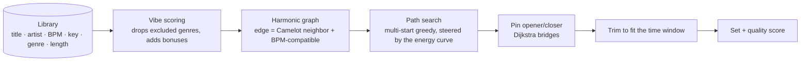

# How D-i-Jkstra works

A DJ library is a weighted directed graph, and building a set is a path problem on it.



## Nodes and edges
Every track is a node, identified by `(title, artist)`. There is an edge `A → B` when:
- **Keys are Camelot neighbors:** same key, relative major/minor (`8A ↔ 8B`), or one step around the wheel (`8A → 7A / 9A`).
- **BPMs are compatible:** within 25 BPM, *or* one track is half/double the other within 8 BPM (a 70 → 140 mix is clean).

## Edge cost
One function, `transition_cost`, is used by the path search, the reorder, Dijkstra and the replacement suggestions:

```
cost = effective_bpm_delta + 2 × key_penalty − style_bonus        key_penalty: same 0 · neighbor 1 · other 4
effective_bpm_delta = min(|a−b|, |2a−b|, |a−2b|)
style_bonus = 3 × log(1 + times you've played this transition)      (only if history is on)
```

Lower is smoother. Half/double-time pairs cost nothing for the tempo jump. Transitions you've actually played become edges even across clashing keys — you've proven they work.

## Building a set
1. **Score** each track for the chosen vibe (`VIBE_CONFIG`): excluded genres score 0 and drop out; BPM-range and genre bonuses plus a small random jitter break ties.
2. **Search.** Every track that fits is tried as the opener. Each step extends to the unvisited neighbor with the lowest cost, plus the distance from the vibe's target energy at that point in the set. The path that fills the most time (then has the lowest total cost) wins. A 2-opt pass then reverses any run of tracks whose reversal lowers the total cost without breaking a transition. (A beam search is also available; on a real 500-track library it matches greedy's quality and is ~3× faster.)
3. **Energy curve.** Each vibe has a target-energy shape on a 1–10 scale, e.g. `[(0, 7), (0.75, 9.5), (1, 8)]` for Rave: warm up, peak three-quarters through, cool slightly. Tracks use your energy rating, or an estimate from BPM. The search is pulled toward that line rather than constrained to it.
4. **Time.** Each track counts from its mix-in to its mix-out (Rekordbox cue points, or 32 bars before the end), because the next track starts while this one is still playing.
5. **Pins and bridges.** A pinned opener/closer is connected to the rest by the Dijkstra shortest path over the graph, never reusing a song. Bridges add time, so the middle is trimmed until the whole set fits the window.

## Lock & regenerate
Locked tracks stay where they are. Each gap between them keeps its time budget and is refilled with new songs by the same search, anchored at both ends: it must start from the locked track before it and end where it can mix into the locked track after it. A breadth-first search from the right-hand anchor tells the search how many hops each track is from it, so it never walks into a dead end.

## Live mode
Given the track playing now and a direction (cool / hold / push = −0.5 / 0 / +0.5 energy per track), candidates are scored on BPM gap + key move + distance from the wanted energy change. Pushing also unlocks the classic energy-boost key moves (+7 and +2 on the wheel), which aren't normally "harmonic" but sound like a lift.

## Why greedy, and where it stops
Finding the *best* harmonic path of a given length is a hard problem (a constrained Hamiltonian-path variant). The multi-start greedy search plus 2-opt is fast (~0.2–0.6 s for 500 tracks) and produces sets that are ~100% harmonic on the demo and real libraries. `scripts/bench_engine.py` compares strategies on your own library.

## Analysis
- **Quality score** = 60% harmonic-transition rate + 40% BPM smoothness.
- **Compatibility** (two songs) = key (40) + BPM (30) + graph distance (30).
- **Orphans** are tracks with no compatible partner; **key gaps** are the thinnest Camelot slots.
- **Clustering** runs KMeans on BPM + circular key position (12 is next to 1) + major/minor, projected to 2D with PCA.
